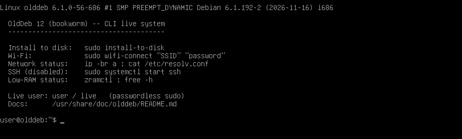

# OldDeb

OldDeb is a tiny, plain & old-hardware-friendly Linux distribution for 32-bit
and 64-bit PCs that still have a job to do.

Debian 12 "bookworm" · command line only · BIOS · i386 + amd64

Read more at **[qqqqr250.github.io/olddeb](https://qqqqr250.github.io/olddeb)**
and [download the latest release](https://github.com/qqqqr250/olddeb/releases/latest).



## Quick start

```sh
gh release download v12 -R qqqqr250/olddeb
sha256sum -c SHA256SUMS
sudo dd if=olddeb-12-i386-cli.iso of=/dev/sdX bs=4M status=progress conv=fsync
```

Boot the medium, log in as `user` / `live` (autologin on tty1, passwordless
`sudo`), then install to a disk:

```sh
sudo install-to-disk
```

| Live ISO | Raw disk image | Rootfs tarball |
|---|---|---|
| live system + installer + persistence | MBR/ext4 + GRUB, `dd` to disk | zstd tar of the root filesystem |
| i386 506 MB · amd64 540 MB | i386 410 MB · amd64 428 MB | i386 414 MB · amd64 430 MB |

Disk image and tarball logins are `user` / `live`; `sudo` asks for the
password and there is no autologin.

## Persistence

Add an ext4 partition labelled `persistence` holding a `persistence.conf`
with the line `/ union`. The default command line already contains
`persistence`, so changes under `/` survive reboots.

## Ventoy

The ISO boots through [Ventoy](https://www.ventoy.net/) on BIOS machines
(tested with 1.1.18, "Boot in normal mode"). UEFI and Secure Boot are not
supported: the ISO is BIOS-only by design. Ventoy's built-in `.dat`
persistence is for casper-based distros and is ignored by `live-boot`, so use
the ext4 persistence partition above instead.

## Build from source

Requires a Debian 12 or Ubuntu host with `live-build`. Builds run outside the
source tree, in `/var/tmp/olddeb-build`:

```sh
git clone https://github.com/qqqqr250/olddeb
cd olddeb
sudo ./scripts/build.sh i386            # or amd64
sudo ./scripts/make-disk-image.sh i386
sudo ./scripts/make-rootfs.sh i386
```

Artifacts are written to `out/`. The full procedure, including persistence and
QEMU tests, is in the [website](https://qqqqr250.github.io/olddeb) and the
verification logs are in [`verification/`](verification/).

## Notes

- i686-class CPU minimum (no 486/Pentium I); 256 MB RAM boots, 512 MB is
  comfortable.
- zram (50 %, zstd), earlyoom and volatile journald keep low-RAM machines
  usable; networking through `dhcpcd`.
- Debian 12 is the last bootable 32-bit Debian; LTS support ends June 2028.

## License

OldDeb is released under the [MIT License](https://opensource.org/licenses/MIT).
